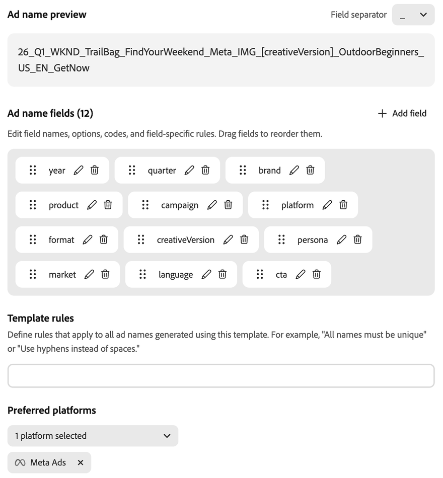

# Gerar nomes de anúncios

A nomenclatura automatizada de anúncios no [!DNL GenStudio for Performance Marketing] ajuda a seguir as convenções de nomenclatura de sua organização ao ativar anúncios. Nomes consistentes são compatíveis com relatórios de desempenho, atribuição e reconciliação de gastos.

Faça upload da sua convenção de nomenclatura para criar um modelo e, em seguida, use-o para gerar nomes a partir de metadados de experiência. Analise os resultados e faça as correções antes de enviar anúncios para suas plataformas.

## Antes de começar

A configuração do modelo é uma tarefa única. Se sua plataforma já tiver um modelo atribuído no Projeto atual, pule para [Gerar nomes para uma ativação](#generate-names-for-an-activation).

Para configurar o modelo, prepare um arquivo do Excel de no máximo 3 MB, com apenas uma folha. Arquivos CSV não são compatíveis. Descreva a convenção de nomenclatura para anúncios individuais, não campanhas ou grupos de anúncios.

Inclua os campos em sua ordem obrigatória, valores permitidos, códigos correspondentes e instruções para escolher valores. Por exemplo, selecionar `Image` para o campo `format` pode produzir `IMG` no nome.

Baixe o [exemplo de convenção de nomenclatura do WKND Meta (Excel)](assets/wknd-meta-naming-convention.xlsx) para explorar uma estrutura de exemplo. Ele inclui definições de campo e valores de exemplo para ano, trimestre, marca, produto, campanha, plataforma, formato, versão criativa, persona, mercado, idioma e CTA.

Substitua os valores e as regras de exemplo pela convenção de sua organização antes de usar o arquivo para suas próprias ativações. Os valores de plataforma do exemplo ilustram as opções de nomenclatura, não uma lista de destinos de ativação compatíveis.

Um gerente de sistema deve atribuir o template às suas plataformas. Projetos diferentes podem usar modelos padrão diferentes para a mesma plataforma.

## Criar um modelo de nomenclatura

Crie um modelo a partir do arquivo de convenção de nomenclatura existente e, em seguida, revise a estrutura extraída antes de usá-la.

1. Abra o Projeto onde deseja usar o modelo.
1. Vá para **[!UICONTROL Mais]** > **[!UICONTROL Configurações]**.
1. Selecione **[!UICONTROL Configurar]** ao lado de **[!UICONTROL Modelo de nome do anúncio]**.

   Se os modelos já existirem, abra **[!UICONTROL Modelo de nome do anúncio]** e selecione **[!UICONTROL Criar modelo]**.

1. Selecione **[!UICONTROL Selecionar arquivo]** na caixa de diálogo **[!UICONTROL Carregar arquivo]**.
1. Escolha seu arquivo do Excel.

   Você também pode arrastar o arquivo para a área de upload. Enquanto **[!UICONTROL Analisando sua planilha...]** é exibido, os campos e valores são mapeados para seu modelo. Isso pode levar alguns minutos.

1. Revise os campos, os valores permitidos e a **[!UICONTROL Visualização do nome do anúncio]**.

   A visualização usa valores de amostra, não os detalhes de um anúncio específico.

1. Selecione **[!UICONTROL Salvar]**.

Os arquivos maiores que 3 MB, os tipos de arquivos não suportados e os arquivos vazios mostram um erro sem alterar os modelos ou atribuições de plataforma existentes.

## Personalizar um modelo

Edite um modelo salvo para ajustar seu nome, campos, separador ou regras.

1. Vá para **[!UICONTROL Mais]** > **[!UICONTROL Configurações]** > **[!UICONTROL Modelo de nome do anúncio]**.
1. Abra o menu de três pontos ao lado do modelo.
1. Selecione **[!UICONTROL Editar]**.
1. Selecione o ícone de lápis ao lado do título para renomear o modelo.
1. Defina o **[!UICONTROL Separador de campo]** para corresponder à sua convenção.
1. Arraste os campos para a ordem necessária.

   Use **[!UICONTROL Adicionar campo]** ou um ícone de lixeira de campo se precisar alterar quais campos são incluídos.

1. Selecione um ícone de lápis de campo para abrir suas configurações.
1. Revise **[!UICONTROL Type]** e **[!UICONTROL Name]** na caixa de diálogo **[!UICONTROL Editar um campo]**.

   Use a **[!UICONTROL Lista suspensa]** para um campo com opções predefinidas ou o **[!UICONTROL Texto livre]** para um valor inserido.

1. Para um campo suspenso, examine as **[!UICONTROL Opções]** e o **[!UICONTROL Código]**.

   **[!UICONTROL Opções]** contém as opções legíveis. **[!UICONTROL Código]** contém os valores correspondentes usados no nome do anúncio. Por exemplo, a opção `Image` usa o código `IMG`.

   Use **[!UICONTROL Adicionar opção]** para adicionar uma opção ou o ícone de menos ao lado de uma opção para removê-la. Valores duplicados em um campo não são permitidos.

1. Insira quaisquer **[!UICONTROL Regras de campo]** necessárias para escolher ou formatar o valor desse campo.

   Para o campo de texto livre `creativeVersion` do exemplo, você pode inserir `Use the experience name as a starting value, with spaces removed.`

1. Selecione **[!UICONTROL Salvar]** na caixa de diálogo do campo.

   Repita a revisão de campo para quaisquer outros campos que precisem de alterações.

1. Digite quaisquer **[!UICONTROL Regras de modelo]** que se apliquem ao nome.

   Por exemplo, digite `Remove spaces from Product and Campaign values.`

1. Selecione **[!UICONTROL Salvar]** na parte superior da página.

A visualização reflete a ordem e o separador de campos atualizados. Reabra o modelo para verificar as alterações salvas.

O editor de campo mostra como as opções legíveis são mapeadas para os códigos incluídos nos nomes gerados:

## Atribuir um modelo às plataformas

Os gerentes de sistema definem o modelo padrão para cada plataforma dentro de um Projeto. Se você não for um gerenciador de sistemas, peça a um deles para concluir este procedimento.

1. Abra o Projeto cujos padrões de plataforma você deseja definir.
1. Vá para **[!UICONTROL Mais]** > **[!UICONTROL Configurações]** > **[!UICONTROL Modelo de nome do anúncio]**.
1. Abra o menu de três pontos ao lado do modelo.
1. Selecione **[!UICONTROL Editar]**.
1. Selecione uma ou mais plataformas em **[!UICONTROL Plataformas preferenciais]**, na parte inferior do editor.
1. Selecione **[!UICONTROL Salvar]**.

Cada plataforma tem um modelo padrão por projeto. Você pode atribuir o mesmo modelo a várias plataformas.

Você pode visualizar e editar modelos entre Projetos, mas pode alterar atribuições somente para o Projeto em que você está no momento.

Substituir o padrão de uma plataforma não exclui o modelo anterior nem altera as atribuições de outros projetos.

O exemplo abaixo mostra a visualização do modelo, a ordem dos campos, as regras e as **[!UICONTROL Plataformas preferenciais]** com Meta Ads selecionados:

## Gerar nomes para uma ativação

Gere nomes depois de preparar a ativação e revisar os metadados de experiência de que seu modelo precisa, como campanha, produto ou persona.

1. Abra **[!UICONTROL Ativar]** no projeto pretendido.
1. Adicione suas experiências a uma ativação.
1. Complete a configuração da plataforma e todas as informações necessárias, incluindo cópia, call-to-action (CTA) e URL do site.
1. Verifique se as experiências têm os metadados necessários para sua convenção de nomenclatura.
1. Selecione **[!UICONTROL Gerar nome do anúncio]** acima da tabela de ativação.

   Aguarde a conclusão de **[!UICONTROL Geração de nomes de anúncio]** antes de examinar os resultados.

1. Revise a coluna **[!UICONTROL Nome do anúncio]**.

A geração se aplica a todos os anúncios nas plataformas com um modelo atribuído, exceto anúncios com substituições ativadas. Os nomes não são gerados automaticamente ao abrir a tabela.

Inicialmente, cada anúncio usa o nome da experiência. Se uma plataforma não tiver um template atribuído, a geração deixará os nomes inalterados e você poderá editá-los manualmente.

Se nenhuma plataforma tiver templates atribuídos, nenhum nome será gerado.

## Corrigir um nome de anúncio individual

Analise os nomes gerados antes de enviar seus anúncios. Os valores ausentes aparecem como espaços reservados para o campo destacado, como `[market]`, e os anúncios afetados mostram **[!UICONTROL Precisa de atenção]**.

A tabela de ativação sinaliza nomes com valores ausentes para que você possa localizá-los e corrigi-los:

1. Selecione a linha do anúncio na tabela de ativação.
1. Selecione **[!UICONTROL Editar nome do anúncio]**.
1. Atualize os menus suspensos ou campos de texto relevantes.
1. Selecione **[!UICONTROL Salvar]**.

Por exemplo, se `market` não tiver valor, insira ou selecione o mercado apropriado para substituir `[market]` no nome.

Verifique o nome atualizado em relação à sua convenção.

## Resolver possíveis nomes duplicados

Nomes de anúncios idênticos na mesma plataforma são sinalizados como duplicatas potenciais.

1. Selecione um dos anúncios afetados.
1. Selecione **[!UICONTROL Editar nome do anúncio]**.
1. Altere o nome para que os dois nomes sejam diferentes.
1. Selecione **[!UICONTROL Salvar]**.

O aviso de possível duplicação é apagado depois que os nomes se tornam diferentes.

## Editar vários nomes de anúncios de uma só vez

Use a edição de itens em massa para aplicar uma correção compartilhada sem substituir valores que devem permanecer diferentes para cada anúncio.

1. Marque os anúncios usando as caixas de seleção de linha.
1. Selecione **[!UICONTROL Editar nome do anúncio]** na barra de ferramentas de seleção.
1. Altere somente os campos que devem ter o mesmo valor nos anúncios selecionados.

   **[!UICONTROL Valores mistos]** significa que os anúncios selecionados atualmente têm valores diferentes para um campo. Deixe esse campo intacto para preservar o valor de cada anúncio.

1. Selecione **[!UICONTROL Salvar]**.
1. Revise os nomes atualizados quanto à precisão e possíveis duplicatas.

Somente os anúncios selecionados são atualizados. Os anúncios não selecionados permanecem inalterados.

O editor de itens em massa exibe **[!UICONTROL Valores mistos]** para campos que diferem entre os anúncios selecionados:

Por exemplo, alterar apenas a persona de `OutdoorBeginners` para `Adventurers` preserva os produtos diferentes. Esses nomes encurtados ilustram a alteração:

| Antes | Depois |
| --- | --- |
| `WKND_TrailBag_OutdoorBeginners` | `WKND_TrailBag_Adventurers` |
| `WKND_RiosShirt_OutdoorBeginners` | `WKND_RiosShirt_Adventurers` |

## Usar um nome de anúncio personalizado

Substitua um nome gerado quando um anúncio precisar de um nome personalizado completo.

1. Selecione a linha do anúncio.
1. Selecione **[!UICONTROL Editar nome do anúncio]**.
1. Ative **[!UICONTROL Substituir nomes de anúncios]**.
1. Insira o nome personalizado.
1. Selecione **[!UICONTROL Salvar]**.

O nome personalizado permanece inalterado quando você gera nomes novamente.

Com a substituição ativada, você pode editar o nome completo em vez de seus campos de modelo individuais:

Para retornar à nomeação baseada em modelo, siga estas etapas:

1. Abra **[!UICONTROL Editar nome do anúncio]** para o anúncio.
1. Desative **[!UICONTROL Substituir nomes de anúncios]**.
1. Selecione **[!UICONTROL Salvar]**.
1. Selecione **[!UICONTROL Gerar nome do anúncio]** acima da tabela de ativação.

Essa ação de geração também se aplica a outros anúncios qualificados na tabela.

## Responder às alterações do modelo

Ao editar uma tabela de ativação, um aviso será exibido se um modelo que ele usa tiver sido alterado ou excluído.

Se o modelo tiver sido alterado, revise o modelo atualizado antes de gerar os nomes novamente. Selecione **[!UICONTROL Gerar nome do anúncio]** para aplicá-lo.

Se o modelo tiver sido excluído ou você precisar de uma substituição, siga estas etapas:

1. Peça a um gerente de sistema para atribuir um modelo de substituição à plataforma afetada no mesmo Projeto.
1. Retorne à tabela de ativação.
1. Selecione **[!UICONTROL Gerar nome do anúncio]**.
1. Revise os nomes atualizados.

Os nomes com substituições ativadas permanecem inalterados durante a regeneração.

## Enviar anúncios para plataformas

Revise seus nomes finais e endereços de campos não resolvidos, duplicatas potenciais e outros problemas **[!UICONTROL Precisa de atenção]** antes de enviar anúncios.

Quando a ativação estiver pronta, selecione **[!UICONTROL Enviar para plataformas]**.

Os nomes publicados correspondem exatamente aos nomes finais em [!DNL GenStudio for Performance Marketing], incluindo nomes gerados, nomes editados por meio de campos de modelo e nomes substituídos.

Para destinos de exibição como Innovid, os nomes são exibidos como nomes criativos.
