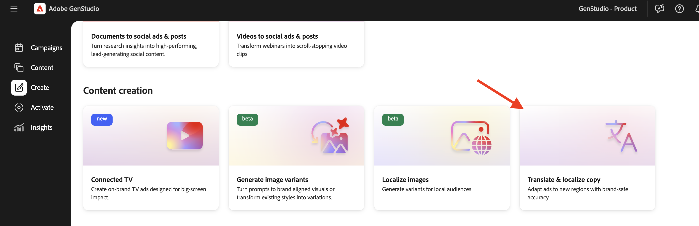
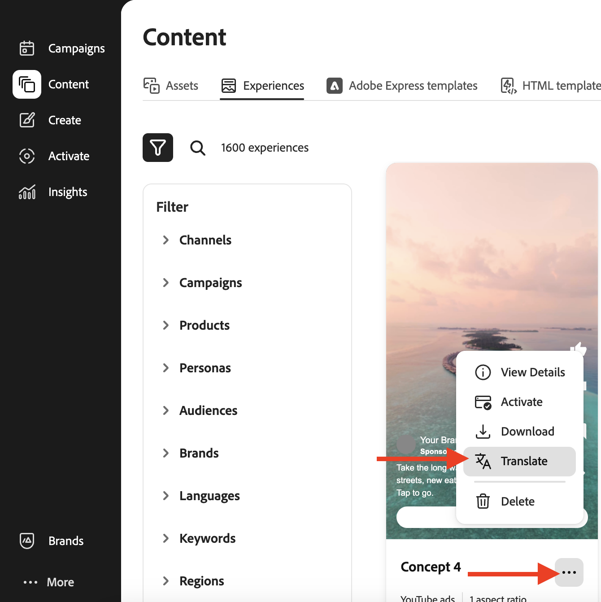
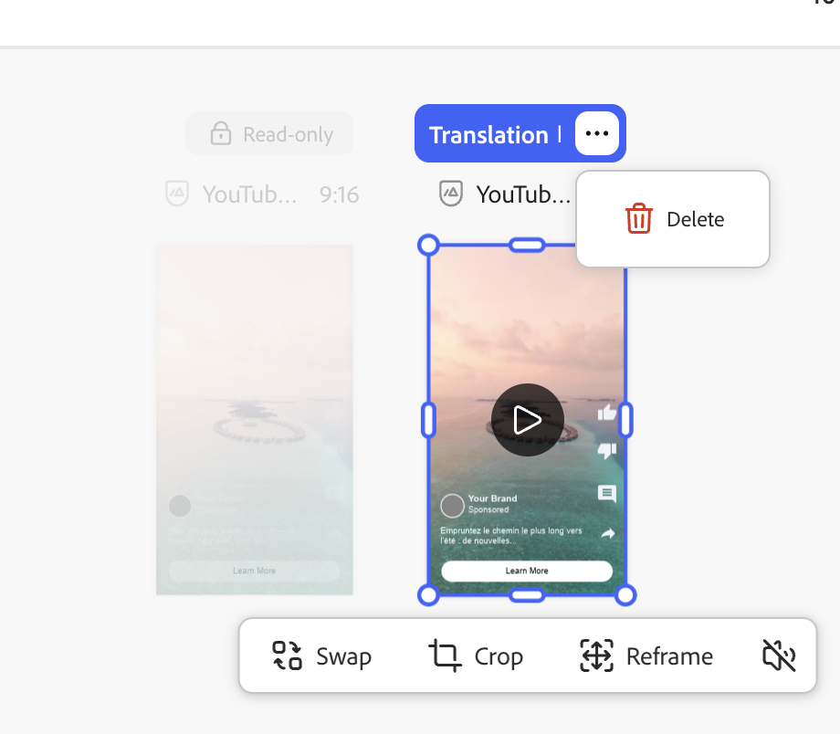

# Traduzir e traduzir experiências

O Adobe [!DNL GenStudio for Performance Marketing] oferece tradução pronta para uso na tela do HTML para que profissionais de marketing globais e regionais possam dimensionar experiências aprovadas em vários idiomas sem ferramentas de tradução externas.

O recurso usa a API aberta do Azure por padrão. Sua organização também pode conectar um serviço de tradução de preferência por meio de [extensões de tradução](/help/extensibility/deploy-app.md#find-translation-extensions).

A tradução começa com uma experiência aprovada salva em [!DNL Content]. A experiência de origem pode estar em qualquer idioma. Cada variante traduzida é aberta na tela [!DNL Create] como um rascunho editável que pode ser exportado, enviado para revisão e publicado como uma experiência separada.

## Experiências suportadas

A tradução pronta para uso na tela do HTML é compatível com:

* [Experiências de email](/help/user-guide/create/email-experiences.md)
* Experiências de mídia paga, incluindo [Meta](/help/user-guide/create/meta-experiences.md), [LinkedIn](/help/user-guide/create/linkedin-experiences.md) e [Display](/help/user-guide/create/display-ad-experiences.md) anúncios

## Antes de começar

Confirme se a experiência que deseja traduzir foi **aprovada** e está disponível na galeria [!DNL Content] _[!UICONTROL Experiências]_. Experiências de rascunho ou em revisão não são fontes de tradução qualificadas.

Se sua organização registrar uma extensão de tradução personalizada, o GenStudio for Performance Marketing usará esse serviço em vez da tradução padrão do Azure Open AI. Consulte [Localizar extensões de tradução](/help/extensibility/deploy-app.md#find-translation-extensions).

## Traduzir de [!DNL Create] {#translate-from-create}

Inicie uma tradução da página de aterrissagem [!DNL Create] para localizar uma experiência aprovada.

{width="600" zoomable="yes"}

**Para traduzir de[!DNL Create]**:

1. Em [!DNL Create], role até a seção _Criação de conteúdo_.
1. Clique em **[!UICONTROL Traduzir e localizar cópia]**.
1. Selecione o email aprovado ou a experiência de mídia paga que deseja traduzir. Clique no botão **[!UICONTROL Usar]**.
1. Selecione os idiomas de destino na lista de idiomas suportados. Clique em **[!UICONTROL Converter]**.

As variantes traduzidas são exibidas na tela.

## Traduzir de [!DNL Content] {#translate-from-content}

Você também pode iniciar a tradução de [!DNL Content] quando estiver navegando nas experiências aprovadas.

### Da galeria de Experiências

{width="500" zoomable="yes"}

**Para traduzir da galeria de Experiências**:

1. Em [!DNL Content], abra a guia **[!UICONTROL Experiências]**.
1. Localize a experiência aprovada que deseja traduzir.
1. Clique no menu de opções (três pontos) no cartão de experiência.
1. Clique em **[!UICONTROL Converter]**.
1. Selecione os idiomas de destino na lista de idiomas suportados. Clique em **[!UICONTROL Converter]**.

## Trabalhar com traduções na tela

Na tela do HTML, a experiência de origem não pode ser editada porque já está aprovada. As experiências de origem em email parecem bloqueadas. É possível editar o texto em variantes traduzidas diretamente na tela. Consulte [Gerenciar variantes](/help/user-guide/create/manage-variants.md) para obter orientação sobre como editar uma cópia de variante.

Experiências traduzidas não executam a validação de marca ou exibem uma pontuação de marca. A experiência original já foi criada com diretrizes da marca, revisada e aprovada.

A regeneração de fragmentos não é compatível com experiências traduzidas.

### Excluir um idioma traduzido

**Para remover um idioma traduzido da tela**:

1. Na tela [!DNL Create], clique no menu de opções (três pontos) no cabeçalho da variante traduzida.
1. Clique em **[!UICONTROL Excluir]**.

{width="500" zoomable="yes"}

O idioma traduzido é removido da tela.

### Atualizar uma tradução de mídia paga

Após editar a cópia de mídia paga traduzida, é possível recarregar a saída de tradução original.

**Para atualizar uma tradução de mídia paga**:

1. Na tela [!DNL Create], abra o menu de opções na variante traduzida editada.
1. Clique em **[!UICONTROL Atualizar tradução]**.

>[!NOTE]
>
>A tradução de atualização está disponível para experiências de mídia paga. No momento, a tradução de email não oferece suporte à atualização de tradução.

## Exportar, revisar e publicar

Depois que as traduções forem carregadas na tela, você poderá exportá-las, enviá-las para aprovação e publicar variantes aprovadas em [!DNL Content].

**Para exportar experiências traduzidas**:

1. Na tela [!DNL Create], clique em **[!UICONTROL Exportar]** na barra de ferramentas.
1. Selecione um formato de exportação.
   * Email: **CSV e imagens** ou **somente HTML**
   * Mídia paga: **CSV + JPG**, **CSV + PNG** ou **HTML + imagens**
1. Clique em **[!UICONTROL Exportar]**.

Você também pode [exportar experiências de [!DNL Content]](/help/user-guide/content/manage-assets.md#export-experiences).

**Para solicitar revisão e aprovação**:

1. Na tela [!DNL Create], clique em **[!UICONTROL Solicitar aprovação]**.
1. Atribua pelo menos um aprovador e envie a solicitação.

Consulte [Solicitar revisão e aprovação](/help/user-guide/approvals/request-review.md) para obter detalhes sobre o fluxo de trabalho de revisão.

**Para publicar as traduções aprovadas**:

1. Depois que os aprovadores aprovarem as variantes traduzidas, clique em **[!UICONTROL Publicar]**.
1. Na janela de publicação, confirme os metadados, como nome da campanha, intervalos de tempo, regiões e palavras-chave.

Consulte [Publicar conteúdo aprovado](/help/user-guide/approvals/publish-content.md).

Cada tradução publicada é salva em [!DNL Content] como uma experiência separada.

## Metadados de experiência traduzidos

As traduções publicadas incluem metadados que vinculam cada variante de volta à origem, incluindo:

* **Título** — segue o padrão `Translation from "<source title>" <channel>`, como `Translation from "Summer campaign" Meta`
* **Criado por** — o usuário que iniciou a tradução
* **Data de criação** — a data da tradução
* **Origem traduzida** — um link para a experiência de origem em [!DNL Content]
* **Traduzido de** — o idioma de origem

## Limitações

Lembre-se das seguintes restrições ao traduzir experiências na tela do HTML:

* A experiência de origem já deve estar aprovada e salva em [!DNL Content].
* A validação da marca não é executada em variantes traduzidas.
* A regeneração de fragmentos não é compatível com experiências traduzidas.
* A tradução de atualização está disponível somente para mídia paga.

## Informações relacionadas

* [Experiências de email](/help/user-guide/create/email-experiences.md)
* [Experiências do Meta](/help/user-guide/create/meta-experiences.md)
* [Exibir experiências de anúncio](/help/user-guide/create/display-ad-experiences.md)
* [Gerenciar ativos e experiências](/help/user-guide/content/manage-assets.md)
* [Localizar extensões de tradução](/help/extensibility/deploy-app.md#find-translation-extensions)
