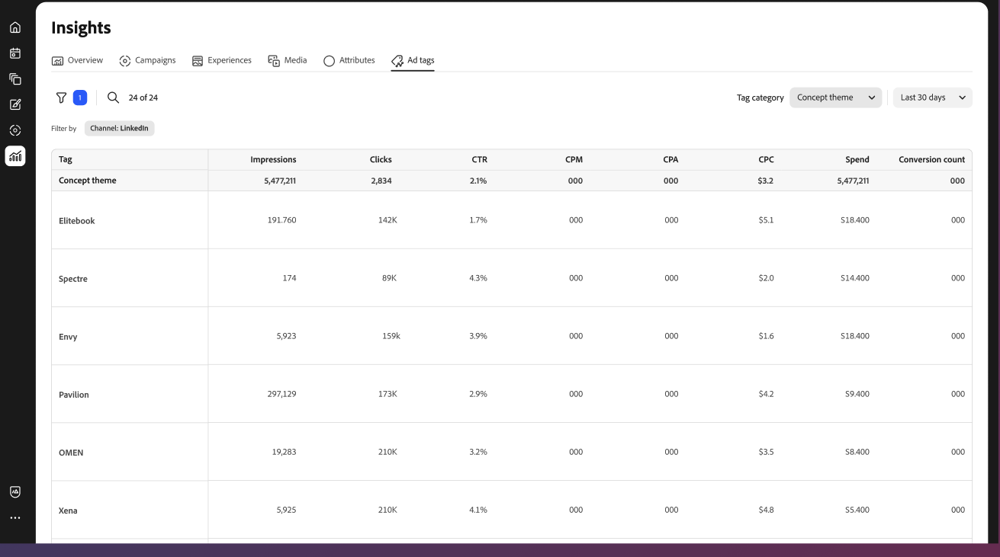

# Visão geral das tags de anúncios

A exibição [!DNL Insights] _[!UICONTROL Marcas de anúncios]_ mostra uma lista de anúncios para a conta de anúncio do canal conectado. Um _anúncio_ é um ativo promocional que inclui conteúdo visual e interativo destinado à distribuição para um público específico como parte de uma campanha de marketing.

{{connect-insights}}

A tabela _[!UICONTROL Marcas de anúncios]_ é organizada com o uso de [!UICONTROL Nomes de anúncios]. Clique no ícone de configurações (cog) acima do lado direito da tabela para alternar as colunas visualizáveis.

A exibição de galeria das _[!UICONTROL Marcas de anúncios]_ mostra uma intercalação de visualizações de anúncios e uma métrica, como a taxa de cliques. Clique no ícone de configurações (cog) acima do lado direito da galeria para abrir **[!UICONTROL Configurações de cartão]** e alternar uma das três métricas visualizáveis:

- CPA (Custo por ação)
- CTR (taxa de cliques)
- CPC (Custo por clique)
- Gastos

{{filter-table}}
